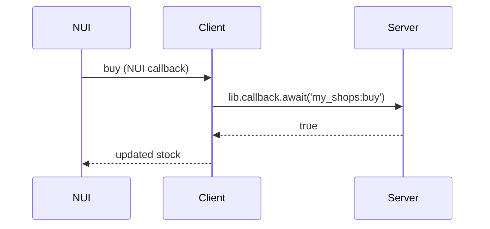

# PR

Use this template for writing the PR body:

```markdown
## Summary

<diagram, diff-sketch, or tree>

## Evidence

- **Before:** <screenshot/output/failing test run>
  **After:** <screenshot/output/passing test run>

## Merge Danger

**Door:** <one-way or two-way>

<optional: description>

**Blast Radius:** <one-word description>

<optional: potential ramifications of merge>
```

If the repo has a pull request template (`.github/pull_request_template.md` or `.github/PULL_REQUEST_TEMPLATE/`), fill in that template instead, using the sections below wherever its headings fit.

## Sections

Skip all preambles and keep prose brief. Use the names the code already uses for resources, events, exports and items.

### Summary

Pick the smallest view that makes the key point clear.

- Show logic or an algorithm as pseudocode:

```text
on(my_shops:buy)
  if player is too far from the shop
    return false
  remove money
  add item
  return true
```

- Show runtime control flow as a call tree, across the client/server boundary where it matters:

```text
client/points.lua nearby
  lib.callback.await('my_shops:buy')
    server/shops.lua buy
      exports.ox_inventory:RemoveItem
      exports.ox_inventory:AddItem
```

- Show NUI structure as a component tree, including state and module boundaries that matter:

```text
<App> (web/src/App.tsx)
  useNuiEvent('setVisible')
  <ShopWindow>
    <ItemGrid> (web/src/components/ItemGrid.tsx)
```

- Show file responsibility or a broad refactor as a shallow file tree:

```text
my_shops/
├── client/      # points, target and NUI messages
├── server/      # validates and charges purchases
├── data/        # shop locations and stock
└── web/         # NUI
```

- Show component interaction, control flow, or data flow with Mermaid:



- Use `diff` when the point is what changes and the surrounding shape already exists. Match the diff shape to the topic.

For a component change:

```diff
 <ShopWindow>
   <ItemGrid>
+  <BasketSummary />
   <CloseButton>
```

For a file-layout change:

```diff
 my_shops/
 ├── client/
+│   └── target.lua   # only required when ox_target is used
 ├── server/
-└── config.lua
+└── data/
+    └── shops.lua
```

For a call-tree or call-stack change:

```diff
 server/shops.lua buy
+  check distance to shop
   exports.ox_inventory:RemoveItem
   exports.ox_inventory:AddItem
-  TriggerClientEvent('my_shops:refresh', -1)
+  TriggerClientEvent('my_shops:refresh', source)
```

For a state or control-flow change:

```diff
 on(my_shops:buy)
-  remove money
+  if count is not a whole number from 1 to 100
+    return false
+  remove money
   add item
```

- Show the whole block when most of it is new, when omitted context would hide ownership or order, or when the user needs a copyable target shape:

```lua
lib.callback.register('my_shops:buy', function(source, shopId, itemName, count)
    local shop = type(shopId) == 'string' and shops[shopId]
    if not shop then return false end
    -- ...
end)
```

#### Guidance

Place each visual next to the short text it supports. Keep only the calls, files, props, states, and boundaries needed to answer the reviewer's question about the change.

You may use one of these, you may use several, it is unlikely you will use all of them. Use your judgement and don't overwhelm the reviewer.

### Evidence

Concrete evidence that the change works. Show a before and after.

Screenshots are S-tier: of the NUI, taken by driving its dev server in a browser, when the environment is set up for it and the change is visual.

Execution-based evidence is A-tier: test results, script output, server console output. Show the exact test that now fails and passes, using pseudocode.

### Merge Danger

Describe whether it's a one-way or two-way door. You can walk back through two-way doors, but not one-way doors. A PR that is cheap to roll back is lower risk. Changes that involve destructive actions or hard-to-reverse decisions are one-way doors: a dropped or renamed database column, a renamed item (saved inventories still hold the old name), a changed KVP key or saved JSON shape.

The blast radius is the potential impact or scope of the changes introduced by this PR. Consider all possibilities. Examples are other resources calling a changed export or listening to a renamed event, every player's saved data, client frame time, the NUI at other resolutions, and convars server owners have already set.
